# ARCHITECTURE — Sales Data Platform trên Microsoft Fabric

> **Bản thi công end-to-end cho dự án thật.** Làm theo từ trên xuống là ra hệ thống chạy production: có những item nào; mỗi tầng ghi bằng lệnh gì; job nào chạy trước, chạy sau; fail ở đâu thì biết bằng cách nào và xử lý ra sao; chạy hằng ngày, chạy lại, nạp lần đầu, backfill thế nào.
> Ví dụ trong file dùng dữ liệu Company A (ERP bán buôn + file bán lẻ). Phần chỉ áp dụng cho môi trường **mô phỏng** nằm ở **Phụ lục A**.
> **File này là nguồn sự thật hiện hành về kiến trúc.** PLAN.md và design/ mô tả bản trước (có Bronze dạng bảng, `meta` 5 bảng, Lookup T-SQL); khi làm đến phần nào thì cập nhật file tương ứng theo §15.
> Trạng thái: architecture hiện hành; platform implementation đang được dựng trong `fabric/platform/` · 2026-10-12

**Mục lục**
1. Luật chơi · 2. Kiến trúc tổng thể · 3. Framework · 4. Ingest & Landing · 5. Silver · 6. Gold · 7. Semantic & refresh · 8. meta, DQ, đối soát · 9. Điều phối: dependency, fail, cảnh báo, lịch · 10. Sổ tay vận hành · 11. Hiệu năng, bảo trì, chi phí · 12. Môi trường, CI/CD, bảo mật & quản trị dữ liệu · 13. Núm vặn khi lớn lên · 14. Lộ trình & Definition of Done · 15. Quyết định & còn mở · Phụ lục A. Mô phỏng

---

## 1. Luật chơi

| # | Luật | Hệ quả |
|---|---|---|
| L1 | **Nguồn chỉ đọc**, có hợp đồng dữ liệu (khoá, cập nhật, xoá, múi giờ, giờ gửi, kênh liên hệ) chốt **trước** khi viết pipeline | design/01 |
| L2 | **Landing là raw bất biến và là bản raw duy nhất**: mỗi lượt Copy một thư mục mới, có manifest, không ghi đè, giữ lâu dài | Dựng lại mọi tầng từ landing |
| L3 | **Mọi lệnh ghi vào bảng dữ liệu (slv, gld) đều idempotent**: MERGE theo khoá, chỉ nhận bản mới hơn, hoặc replaceWhere theo phạm vi. Bảng log audit (`table_run`, `check_result`) là append có chủ đích | Chạy 1 lần hay 10 lần ra cùng kết quả; file trùng không sinh trùng |
| L4 | **Watermark/checkpoint chỉ tiến**, và chỉ tiến sau khi dữ liệu đã nạp thành công | Crash thì làm lại phần đó, không mất |
| L5 | **Hai kiểu chạy** normal / rerun, cộng chạy lẻ bảng, chạy từ một tầng, chạy một khoảng ngày | Sửa sự cố không cần chạy cả hệ thống |
| L6 | **Không mất, không im lặng**: dòng lỗi vào quarantine kèm lý do; lỗi vận hành làm pipeline FAILED và có cảnh báo | |
| L7 | **Report chỉ đổi khi cả chuỗi PASS** | Người dùng không bao giờ thấy số nửa vời |
| L8 | **Đối soát count + amount** ở mỗi ranh giới | Report = SQL = nguồn |
| L9 | **Thêm nguồn hoặc bảng = thêm config**, không viết pipeline mới | Scale theo số bảng |
| L10 | **Chỉ chạy phần có thay đổi**, ở từng mức (Copy, delivery, Silver, Gold); tối đa 1 session Spark mỗi lượt | Chi phí tỉ lệ với lượng thay đổi, không tỉ lệ với số bảng |
| L11 | **Git là nguồn sự thật**; không hardcode môi trường; bí mật không nằm trong Git | |
| L12 | **Đo rồi mới tối ưu** | |

---

## 2. Kiến trúc tổng thể

### 2.1 Ngữ cảnh

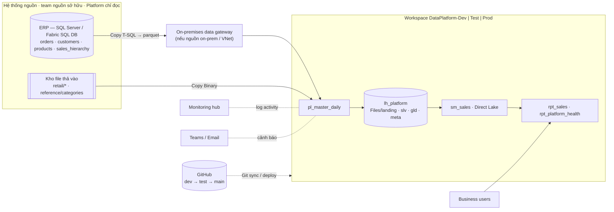

### 2.2 Luồng qua các tầng

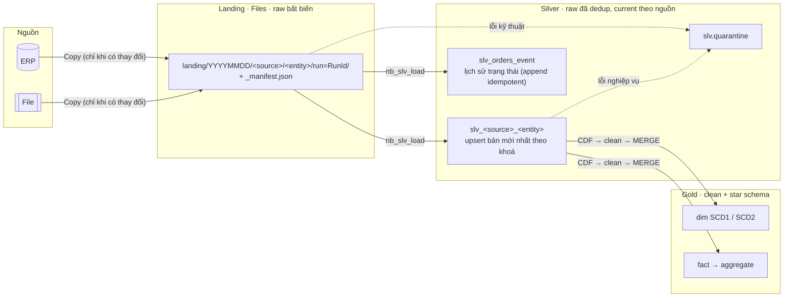

| Tầng | Là gì | Biết "cái gì mới" bằng | Ghi bằng |
|---|---|---|---|
| **Landing** | File gốc nguyên byte, chia theo ngày batch; **đóng vai Bronze** | watermark / checksum nguồn | Copy vào thư mục mới + `_manifest.json` |
| **Silver** | Raw đã dedup: mỗi nguồn một bảng, giữ giá trị gốc, chỉ chuẩn hoá khoá và cột thời gian để dedup | delivery có manifest mà chưa LOADED | MERGE upsert-newer; snapshot thêm soft delete |
| **Gold** | Clean + mô hình: parse, chuẩn hoá giá trị, hợp nhất nguồn, dim/fact | Silver Delta versions hiện tại; CDF `availableNow` sau spike K9 | MERGE / SCD2 MERGE / replaceWhere |

**Vì sao không có bảng Bronze:**
- Landing đã làm đủ 3 việc của Bronze: giữ y nguyên, không ghi đè, phát lại được.
- Lịch sử không mất: trạng thái đơn ở `slv_orders_event`; lịch sử master ở SCD2 của Gold; luôn dựng lại được từ landing.
- Bỏ được 1 lần ghi Delta, 9 bảng và 1 bước chạy.

**Cái giá:**
- Landing **không được xoá** (chỉ chuyển tầng lưu trữ rẻ).
- Raw không có bảng sẵn; xem bằng `read_landing()`.
- Full reload phải parse lại file.

### 2.3 Item

| Nhóm | Item | Session |
|---|---|---|
| Lakehouse | `lh_platform` (schema `slv` `gld` `meta`; Files `landing/`, `_checkpoints/`) | — |
| Dùng chung | `nb_config` (SOURCES, TABLES) · `nb_common` (SQL function + helper §3.9) | `%run` |
| Ingest | `nb_ingest_plan` · activity Copy trong `pl_daily_core` | session của lượt |
| Xử lý | `nb_process` → `nb_slv_load` · `nb_gld_dims` · `nb_gld_fact` · `nb_dq` · `nb_ops_recon` (qua `runMultiple`) | **cùng 1 session** |
| Setup / vận hành | `nb_setup_ddl` · `nb_ops_eda` · `nb_ops_key_recon` (phát hiện xoá cứng, §4.6) | tay / lịch tuần |
| Pipeline | `pl_master_daily` (vỏ, cảnh báo) · `pl_daily_core` · `pl_backfill` · `pl_sla_watch` · `pl_maintenance` | |
| BI | `sm_sales` · `rpt_sales` · `rpt_platform_health` | |

Bảng: `slv` 11 (9 nguồn + `slv_orders_event` + `quarantine`) · `gld` 6 · `meta` 3 → **20**. View: `meta.v_watermark`, `slv.v_quarantine_open`, `slv.v_current_keys`.

---

## 3. Framework

### 3.1 Config là code — `nb_config`

Config là hai danh sách trong notebook `nb_config`: version trong Git, review qua PR, deploy cùng code, kiểm hợp lệ ngay khi `%run`. Không có bảng `cfg_*`.

```python
SOURCES = [   # 1 dict = 1 entity nguồn = 1 bảng slv.slv_<source>_<entity>
  dict(source_system="wholesale", entity="orders", connection="erp_sql",
       load_strategy="db_incremental",             # db_incremental | db_full_snapshot | db_cdc | file_new_or_changed
       source_object="dbo.orders", watermark_column="updated_at",
       source_clock="utc",                         # utc | local: updated_at theo giờ nào của nguồn
       commit_lag_minutes=5, lookback_minutes=1440,
       kind="event",                               # event: dòng = sự kiện · snapshot: ảnh đầy đủ → vắng = xoá
       business_keys=["order_no", "product_code"], order_by="updated_at",
       source_timezone="UTC",                      # để đổi sang UTC ở Silver (TBD-EDA)
       expected="daily",                           # daily | on_change → pl_sla_watch
       hard_delete_check=dict(days=90, weekday=6), # §4.6
       owner="erp-team", load_order=50, is_active=True),
  dict(source_system="retail", entity="orders", connection="retail_drop",
       load_strategy="file_new_or_changed", source_object="inbound/retail/orders",
       lookback_minutes=1440, settle_minutes=5,
       kind="event", business_keys=["order_no", "product_code"], order_by="updated_at",
       source_timezone="Asia/Ho_Chi_Minh", expected="daily",
       owner="retail-team", load_order=50, is_active=True),
  dict(source_system="wholesale", entity="customers", connection="erp_sql",
       load_strategy="db_full_snapshot", source_object="dbo.customers",
       kind="snapshot", business_keys=["customer_code"], order_by=None,
       pii_columns=["customer_name", "address"],   # §12.3
       expected="on_change", owner="erp-team", load_order=20, is_active=True),
  # … các entity còn lại
]

TABLES = [    # 1 dict = 1 bảng gld
  dict(table_name="gld.gld_f_sales_line", notebook="nb_gld_fact",
       depends_on=["slv.slv_wholesale_orders", "slv.slv_retail_orders",
                   "gld.gld_d_customer", "gld.gld_d_product", "gld.gld_d_salesman", "gld.gld_d_date"],
       load_pattern="fact_merge", business_keys=["order_no", "product_code"], cluster_by=None,
       dq=dict(not_null="order_no,product_code", unique="order_no,product_code", quarantine_max_pct=5),
       sla_local_time="07:30", owner="de-team", is_active=True),
  # …
]
validate(SOURCES, TABLES)   # khoá trùng · depends_on tồn tại · DAG không vòng · field bắt buộc theo strategy
```

### 3.2 Định danh

| Định danh | Nghĩa | Ví dụ | Rerun giữ? |
|---|---|---|---|
| `batch_id` | ngày batch `YYYYMMDD` = `p_load_date` | `20260105` | có |
| `delivery_id` | một lượt Copy trong batch (RunId); một batch có thể có nhiều delivery | `run=8f2c…` | có |
| `_delivered_at_utc` | thời điểm delivery hoàn tất (từ manifest); **dùng làm tie-breaker**, vì RunId là GUID không có thứ tự | `2026-01-06 01:00:12` | có |
| `run_id` | lượt pipeline đang chạy | RunId | không |

Truy vết ngược: report → `gld._run_id` → `slv._batch_id`, `_delivery_id`, `_source_file` → `landing/<batch>/<src>/<entity>/run=<delivery>/` → nguồn.

### 3.3 Tham số chuẩn

| Tham số | Giá trị | Mặc định |
|---|---|---|
| `p_load_date` | `yyyy-MM-dd` = batch | rỗng → hôm qua giờ VN |
| `p_load_date_to` | rerun một **khoảng** batch trong **1 lượt, 1 session** | = `p_load_date` |
| `p_mode` | `normal` (lấy mới từ nguồn + xử lý phần chưa xử lý) · `rerun` (không gọi nguồn, xử lý lại batch đã có) | `normal` |
| `p_from_layer` | `ingest` · `slv` · `gld` | `ingest` |
| `p_entities` | `ALL` hoặc danh sách (`retail.orders`, `gld.gld_f_sales_line`…) | `ALL` |
| `p_window_start`, `p_window_end` | normal: lấy nguồn trong khoảng chỉ định thay vì theo watermark (nạp lại, nạp lần đầu theo khối) | rỗng |
| `p_full_reload` | dựng lại bảng được chọn và **bắt buộc kéo theo** mọi bảng Gold phía sau | `false` |

```
p_load_date mặc định:
@if(empty(pipeline().parameters.p_load_date),
    formatDateTime(addDays(convertFromUtc(utcNow(),'SE Asia Standard Time'),-1),'yyyy-MM-dd'),
    pipeline().parameters.p_load_date)
```

### 3.4 Hai kiểu chạy

| | Ingest | Silver | Gold |
|---|---|---|---|
| **normal** | Copy phần mới (§4) vào batch `p_load_date` | delivery **có manifest, chưa LOADED** (kể cả phần dở của lượt trước), theo thứ tự ngày | bảng có Silver phía trên đổi kể từ lần SUCCEEDED gần nhất (CDF) |
| **rerun** | không Copy | mọi delivery của batch `[p_load_date, p_load_date_to]` | khoá bị chạm bởi các batch đó (§6.7) |
| + `p_window_start/_end` | Copy đúng khoảng đó | như normal | như normal |
| + `p_full_reload` | — | truncate bảng được chọn → toàn bộ landing, theo thứ tự ngày | truncate → toàn bộ Silver; checkpoint mới |

### 3.5 Ai quyết định gì

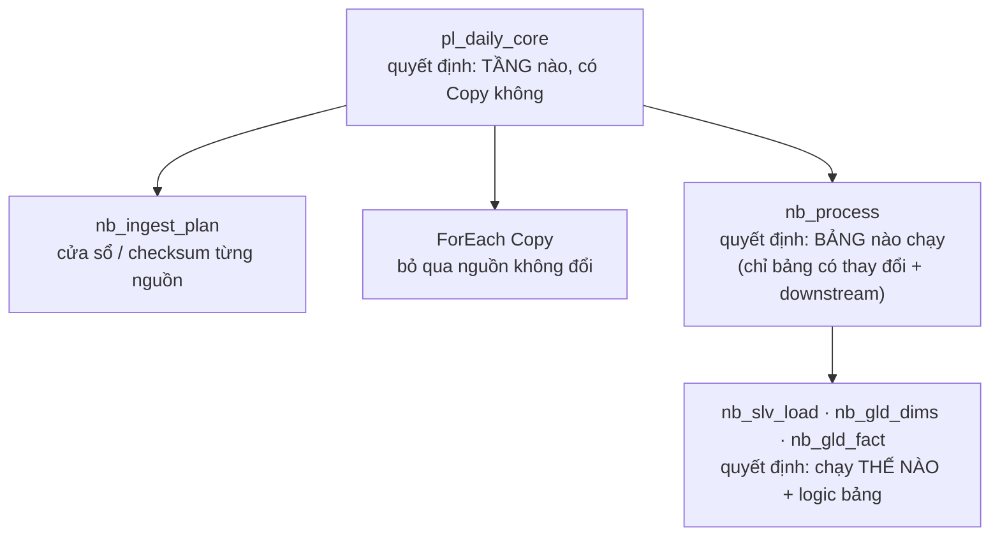

| Cấp | Quyết định | Không quyết định |
|---|---|---|
| Pipeline | tầng nào; nguồn nào cần Copy | bảng nào, cách ghi |
| `nb_process` | bảng nào (có thay đổi + downstream + `p_entities`), thứ tự | cách ghi |
| Notebook xử lý | stream phần mới / làm lại batch / dựng lại; logic | chạy hay không |

Notebook xử lý chỉ có 3: `nb_slv_load` (**generic cho mọi nguồn**), `nb_gld_dims`, `nb_gld_fact`.

### 3.6 Session Spark

Cái tốn thời gian và CU là **mở session mới**, không phải số file notebook.

| Cách gọi | Session |
|---|---|
| Activity Notebook trong pipeline | mới, trừ khi bật *high concurrency for pipelines* và dùng chung session tag |
| `%run`, `notebookutils.notebook.runMultiple` | dùng session đang chạy |

Thiết kế:
- Pipeline chỉ có **2 activity Notebook** (`nb_ingest_plan`, `nb_process`) với cùng session tag `daily`, nên chỉ một session mỗi lượt (spike K6).
- Mọi notebook khác chạy qua `runMultiple`.
- `pl_sla_watch` dùng T-SQL, không Spark.
- Điều kiện để dùng chung được session: cùng default lakehouse, cùng environment, cùng Spark config. Tránh `%%configure` ở notebook con.

### 3.7 Chỉ chạy phần có thay đổi

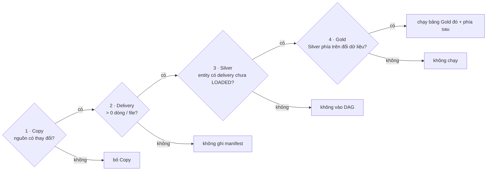

| Mức | Bỏ qua khi | Cách biết |
|---|---|---|
| 1 Copy | snapshot DB không đổi · file không có file mới · incremental không có dòng mới | snapshot: `COUNT_BIG(*)` + `CHECKSUM_AGG(BINARY_CHECKSUM(*))` so với lần trước (Copy bắt buộc mỗi Chủ nhật để phòng checksum trùng); file: filter LastModified; incremental: Copy trả 0 dòng |
| 2 Delivery | Copy ra 0 dòng / 0 file | output Copy → không ghi manifest |
| 3 Silver | entity không có delivery chưa LOADED | manifest trừ `ingestion_batch` |
| 4 Gold | không bảng Silver phía trên nào có commit **thay đổi dòng** kể từ `table_run.source_versions` của lần SUCCEEDED gần nhất | `DESCRIBE HISTORY` + `operationMetrics` |

- Snapshot nạp lại y hệt: MERGE so `_record_hash`, không đổi dòng nào, nên Gold không chạy.
- Gold fail hôm trước: mức 4 thấy chưa xử lý nên hôm sau tự chạy bù.
- Ngày không có gì: chỉ tốn `nb_ingest_plan` cộng vài giây để `nb_process` kiểm rồi thoát; **không refresh report**.
- Tỉa chỉ để tiết kiệm: chạy thừa một bảng cũng không sai (L3).

### 3.8 Khung chuẩn notebook xử lý

```
cell 1  parameters: p_load_date, p_load_date_to, p_run_id, p_mode, p_entities, p_full_reload
cell 2  %run nb_config  ·  %run nb_common
cell 3  log_table_run(event="STARTED")
cell 4  def process(...)       ← logic bảng, idempotent
cell 5  chạy theo mode         ← normal (stream / pending) · rerun (batch range) · full reload
cell 6  log_table_run(event="SUCCEEDED", metrics, source_versions);  notebookutils.notebook.exit(json)
        (except → log_table_run(event="FAILED", error) → raise)
```

### 3.9 Helper trong `nb_common`

| Nhóm | Hàm |
|---|---|
| SQL function | `clean_text`, `clean_code`, `to_amount`, `parse_ts`, `parse_date`, `norm_key`, `std_status`, `std_gender`, `std_position`, `std_brand`, `std_tax_rate`, `status_sequence`, `is_sales_recognized` |
| Config | `validate`, `select_sources(p_entities)`, `select_tables(p_entities)`, `add_downstream` |
| Landing | `list_deliveries(batch_range)`, `pending_deliveries()`, `read_manifest`, `read_delivery` (parquet / CSV toàn chuỗi + cột kỹ thuật), `read_landing` (xem raw khi điều tra) |
| Ghi | `merge_upsert_newer`, `merge_snapshot`, `merge_insert_only`, `write_quarantine` |
| Gold | `read_changes` (CDF stream), `upstream_changed_since`, `last_success_versions` |
| Audit | `log_table_run`, `log_check`, `set_commit_metadata` (`userMetadata` = run_id, batch, op) |
| Điều phối | `node`, `run_dag` (bọc `runMultiple`, gom lỗi) |

---

## 4. Ingest & Landing

### 4.1 Chiến lược theo loại nguồn

| Chiến lược | Khi nào | Lấy gì | Watermark |
|---|---|---|---|
| `db_cdc` | **ưu tiên** khi nguồn bật CDC / Change Tracking hoặc dùng được Fabric Mirroring: có cả update **và delete** | thay đổi từ LSN / version đã lưu | LSN / version |
| `db_incremental` | có `updated_at` tin cậy + index; nguồn không xoá cứng (hoặc có §4.6) | `updated_at > wm − lookback AND updated_at < now_nguồn − commit_lag` | `max(updated_at)` đã nạp |
| `db_full_snapshot` | bảng nhỏ / không có cột thay đổi tin cậy / cần phát hiện xoá | `SELECT *`, chỉ khi checksum đổi | `source_checksum` |
| `file_new_or_changed` | file thả vào storage | file có `LastModified ∈ [wm − lookback, run_start − settle)` | `run_start − settle` (UTC) |

**Cận trên tính ngay ở nguồn** (dự án thật): `now_nguồn` là `SYSUTCDATETIME()` (khi `source_clock = utc`) hoặc `SYSDATETIME()` (khi `local`), chạy **trên chính nguồn**, nên không bao giờ so hai đồng hồ khác nhau. `commit_lag_minutes` chừa các transaction đang dở (`updated_at` gán trước khi commit). Lookback bắt dòng commit trễ hơn nữa; phần lấy dư bị upsert bỏ qua.

```sql
-- db_incremental: source query của Copy
SELECT * FROM @{item().source_object}
WHERE @{item().watermark_column} >  '@{item().window_start}'
  AND @{item().watermark_column} <  DATEADD(minute, -@{item().commit_lag_minutes},
                                            @{if(equals(item().source_clock,'utc'),'SYSUTCDATETIME()','SYSDATETIME()')})
  @{if(empty(item().window_end), '', concat('AND ', item().watermark_column, ' < ''', item().window_end, ''''))}
```

### 4.2 Landing — batch trước, entity sau

```
lh_platform/Files/landing/
  20260105/                                  ← batch_id
    wholesale/orders/run=8f2c…/              ← delivery: thư mục mới mỗi lượt, không ghi đè
      part-0000.parquet
      _manifest.json                         ← có file này = delivery hoàn chỉnh
    retail/orders/run=8f2c…/orders_20260105.csv
                         /_manifest.json
  20260106/ …
```

```json
{"batch_id":"20260105","source_system":"wholesale","entity":"orders","delivery_id":"8f2c…",
 "load_strategy":"db_incremental","window_start":"2026-01-04 05:58:00","window_end":null,
 "rows_copied":62,"files_written":1,"source_checksum":null,
 "delivered_at_utc":"2026-01-06 01:00:12"}
```

Quy tắc:
1. **Có manifest mới là delivery hợp lệ.** Copy lỗi giữa chừng thì không có manifest; thư mục bị bỏ qua và dọn sau 7 ngày.
2. **Bất biến:** không ghi đè, không xoá thư mục có manifest (ngoại lệ: §12.3 quyền xoá dữ liệu; Phụ lục A reset mô phỏng).
3. **Định dạng:** DB thì parquet (giữ kiểu); file thì Binary (nguyên byte, tên gốc).
4. **Delivery rỗng không có manifest** (0 dòng / 0 file).
5. **Vòng đời:** giữ lâu dài; sau 90 ngày chuyển sang tầng lưu trữ rẻ.
6. **Quyền ghi:** chỉ identity của pipeline.
7. **Đối soát Source ↔ landing tự động** nhờ manifest: db so số dòng, file so số file.

### 4.3 `nb_ingest_plan`

```python
%run nb_config
%run nb_common
run_start = datetime.utcnow()
wm = {(r.source_system, r.entity): r for r in spark.table("meta.v_watermark").collect()}

plan = []
for s in select_sources(SOURCES, p_entities):
    w = wm.get((s["source_system"], s["entity"]))
    item = {**s, "batch_id": yyyymmdd(p_load_date), "run_start": fmt(run_start),
            "last_checksum": w.source_checksum if w else None,
            "force_copy": run_start.weekday() == 6 or p_window_start != ""}
    st = s["load_strategy"]
    if st in ("db_incremental", "file_new_or_changed"):
        base = parse(w.watermark_value) if w and w.watermark_value else datetime(1900, 1, 1)
        item["window_start"] = p_window_start or fmt(base - minutes(s["lookback_minutes"]))
        item["window_end"]   = p_window_end or (fmt(run_start - minutes(s["settle_minutes"]))
                                                if st == "file_new_or_changed" else None)
    plan.append(item)
notebookutils.notebook.exit(json.dumps(sorted(plan, key=lambda x: x["load_order"])))
```

### 4.4 Copy

| Nhánh | Source | Ghi chú |
|---|---|---|
| db_incremental | query §4.1 | bảng lớn: *Partition option = Dynamic range* |
| db_full_snapshot | `SELECT * FROM <bảng>`, chỉ khi `if_should_copy` | |
| db_cdc | `cdc.fn_cdc_get_net_changes_…` / Mirroring | làm khi nguồn bật |
| file | Binary · folder `source_object` · *Filter by last modified* `[window_start, window_end)` | |

Sink: `landing/@{item().batch_id}/@{item().source_system}/@{item().entity}/run=@{pipeline().RunId}/`

Kiểm snapshot trước khi Copy (mức 1):
```sql
SELECT CONCAT(COUNT_BIG(*), '|', CHECKSUM_AGG(BINARY_CHECKSUM(*))) AS checksum FROM @{item().source_object}
```
Copy khi `checksum ≠ last_checksum` hoặc `force_copy`. `BINARY_CHECKSUM` bỏ qua các kiểu không so sánh được (xml, text…): nếu bảng có các cột đó thì đưa `max(updated_at)` vào checksum.

### 4.5 Nạp lần đầu (initial load)

Bảng lớn **không** lấy một lần từ 1900. Dùng `pl_backfill` theo khối tháng: mỗi lượt `p_window_start` / `p_window_end` là một tháng, `p_load_date` = ngày nạp, chạy **tuần tự**. Sau đó bật lịch hằng ngày; watermark tự nối tiếp từ khối cuối.

### 4.6 Xoá cứng ở nguồn

| Chiến lược | Phát hiện xoá |
|---|---|
| `db_cdc` | có sẵn (operation = delete) |
| `db_full_snapshot` | khoá vắng trong ảnh mới → `is_deleted` (§5.3) |
| `db_incremental` | **không thấy được** qua watermark. Nếu hợp đồng nguồn nói có thể xoá: `nb_ops_key_recon` (lịch tuần) lấy **chỉ khoá** trong cửa sổ `hard_delete_check.days` từ nguồn, so với Silver, khoá vắng → `is_deleted = true` |
| file snapshot | khoá vắng trong file snapshot mới |

---

## 5. Silver — `nb_slv_load` (generic cho mọi nguồn)

### 5.1 Bảng và cột

| Bảng | 1 dòng = | Khoá | Ghi |
|---|---|---|---|
| `slv_<source>_<entity>` | trạng thái **mới nhất** của một khoá theo nguồn đó | `_bk` | MERGE upsert-newer; snapshot thêm soft delete |
| `slv_orders_event` | một sự kiện trạng thái đơn (mọi nguồn) | xem §5.4 | MERGE insert-only (append idempotent) |
| `slv.quarantine` | một dòng lỗi | §5.5 | replaceWhere / MERGE |

- **Giá trị nghiệp vụ giữ y như nguồn** (ERP có kiểu, CSV là chuỗi). Silver không làm sạch nghiệp vụ.
- **Chuẩn hoá đúng thứ cần để dedup:** `_bk` = `clean_code` các cột khoá nối bằng `|`; `_updated_at_utc` = `parse_ts` + đổi sang UTC theo `source_timezone`; `_snapshot_date` (snapshot).
- **Cột kỹ thuật:** `_batch_id, _delivery_id, _delivered_at_utc, _source_file, _row_no, _ingested_at, _run_id, _record_hash, is_deleted`.
- `TBLPROPERTIES (delta.enableChangeDataFeed = true)` **ngay khi tạo bảng**.
- PII giữ nguyên ở Silver (quyền đọc hạn chế, §12.3).

### 5.2 Thuật toán

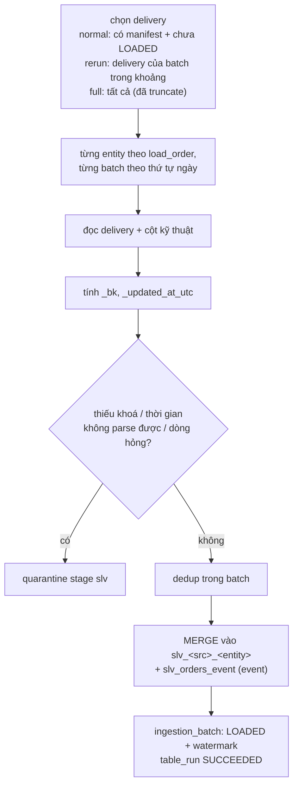

- **Dedup trong batch:** `row_number() OVER (PARTITION BY _bk ORDER BY _updated_at_utc DESC, _delivered_at_utc DESC, _source_file DESC, _row_no DESC) = 1`. Snapshot thì lấy delivery mới nhất trong batch.
- **Mỗi batch là một commit**, theo thứ tự ngày, nên CDF có từng phiên bản cho SCD2.
- **Lỗi một entity:** ghi `FAILED` + `error_message`, làm tiếp entity khác, cuối cùng `raise`. Delivery lỗi vẫn chưa LOADED, nên lượt sau tự làm lại.

### 5.3 Mẫu MERGE

**event** (orders) — current:
```sql
MERGE INTO slv.slv_retail_orders t USING v_dedup s
ON t._bk = s._bk
WHEN MATCHED AND (s._updated_at_utc > t._updated_at_utc
   OR (s._updated_at_utc = t._updated_at_utc AND s._delivered_at_utc > t._delivered_at_utc))
  THEN UPDATE SET *
WHEN NOT MATCHED THEN INSERT *;
```

**snapshot** (master): ảnh mới hơn thắng; khoá vắng trong ảnh mới thì `is_deleted`.
```sql
MERGE INTO slv.slv_wholesale_customers t USING v_dedup s
ON t._bk = s._bk
WHEN MATCHED AND s._snapshot_date >= t._snapshot_date AND (t._record_hash <> s._record_hash OR t.is_deleted)
  THEN UPDATE SET *, t.is_deleted = false
WHEN NOT MATCHED THEN INSERT *
WHEN NOT MATCHED BY SOURCE AND NOT t.is_deleted AND t._snapshot_date < '${batch_date}'
  THEN UPDATE SET t.is_deleted = true, t._snapshot_date = '${batch_date}';
```
`_snapshot_date` = ngày **thay đổi gần nhất**. Rerun ngày cũ không kéo master về quá khứ: ảnh cũ có ngày nhỏ hơn nên thua.

**Vì sao không cần hash file:** file gửi trùng (y hệt, đổi tên, bị chép lại do lookback) cho ra cùng `_bk` + `_updated_at_utc`, nên MERGE không đổi gì.

### 5.4 `slv_orders_event` — lịch sử trạng thái

```sql
-- append IDEMPOTENT: chỉ có nhánh NOT MATCHED → không sửa/đè dòng đã có; rerun / file trùng không nhân đôi
MERGE INTO slv.slv_orders_event t USING v_events s          -- mọi dòng hợp lệ của batch
ON  t.source_system = s.source_system AND t._bk = s._bk
AND t.order_status = s.order_status AND t._updated_at_utc = s._updated_at_utc
WHEN NOT MATCHED THEN INSERT *;
```
Khoá sự kiện chờ EDA [D50]:
- **A (tạm dùng):** `(source, _bk, status, updated_at)`. Không mất sự kiện, nhưng file sửa typo cùng `updated_at` để lại cả bản sai; Gold dedup sau `std_status`.
- **B:** `(source, _bk, updated_at)`, kèm `WHEN MATCHED AND s._delivered_at_utc > t._delivered_at_utc THEN UPDATE`. Chỉ đúng nếu EDA chứng minh không có `(source, _bk, updated_at)` nào mang 2 status khác nhau.

### 5.5 Quarantine — một bảng, hai giai đoạn

| Stage | Lỗi | Ghi | Ví dụ |
|---|---|---|---|
| `slv` (kỹ thuật) | không khoá, thời gian không parse được, dòng CSV hỏng | `replaceWhere stage='slv' AND entity=… AND _batch_id=…` | `order_no` rỗng |
| `gld` (nghiệp vụ) | giá trị không nhận ra, sai miền | MERGE theo `(entity, business_key)`: còn lỗi thì upsert, đã hợp lệ thì DELETE | `order_status = 'Deliverd'` |

Cột: `stage, entity, _batch_id, business_key, source_updated_at_utc, dq_reason, row_json, _run_id, quarantined_at_utc`.

```sql
-- khoá hiện hành của mọi bảng Silver (nb_setup_ddl sinh từ SOURCES)
CREATE OR REPLACE VIEW slv.v_current_keys AS
SELECT 'wholesale.orders' AS entity, _bk, _updated_at_utc FROM slv.slv_wholesale_orders
UNION ALL SELECT 'retail.orders', _bk, _updated_at_utc FROM slv.slv_retail_orders
-- UNION ALL … mọi entity
;
-- dòng lỗi CHƯA được giải quyết: stage gld luôn mở (đã hợp lệ thì bị xoá); stage slv mở khi chưa có bản hợp lệ mới hơn
CREATE OR REPLACE VIEW slv.v_quarantine_open AS
SELECT q.* FROM slv.quarantine q
LEFT JOIN slv.v_current_keys c ON c.entity = q.entity AND c._bk = q.business_key
WHERE q.stage = 'gld' OR q.business_key IS NULL OR c._updated_at_utc IS NULL
   OR c._updated_at_utc < q.source_updated_at_utc;
```

### 5.6 Schema drift

| Tình huống | Silver | Gold |
|---|---|---|
| Cột mới | `mergeSchema` (dòng cũ NULL) + `schema_changes` + cảnh báo | không tự dùng; PR rồi full reload bảng liên quan |
| Cột mất | NULL cho batch mới + cảnh báo | DQ not-null bắt |
| ERP đổi kiểu | fail entity, không tự ép | — |

---

## 6. Gold — clean + mô hình

### 6.1 Đọc thay đổi từ Silver

```python
def read_changes(slv_table):               # normal: stream CDF, checkpoint Files/_checkpoints/gld/<gold_table>/<slv_table>
    return (spark.readStream.option("readChangeFeed", "true").table(slv_table)
            .where("_change_type IN ('insert','update_postimage','delete')"))
```
`writeStream.foreachBatch(process).trigger(availableNow=True)` xử lý hết thay đổi mới rồi dừng; Spark tự nhớ version đã đọc. `process` **không dùng giá trị trong CDF**: nó chỉ lấy **khoá**, rồi đọc bản current của Silver. Nhờ vậy truncate/replay Silver hay thứ tự micro-batch đều không làm sai.

### 6.2 Clean (trong `process`)

`① khoá thay đổi → ② đọc bản current của mọi nguồn cho các khoá đó → ③ parse → ④ std_* → ⑤ lỗi nghiệp vụ → quarantine gld · flag → ⑥ hợp nhất nguồn → ⑦ MERGE`

| Đích | Hợp nhất / tie-breaker |
|---|---|
| orders (fact) | `_updated_at_utc` mới nhất → `status_sequence` cao hơn → wholesale. **Logic "orders current" (Q10, PySpark) nằm ở đây** |
| customer | theo cột: giá trị khác NULL có `updated_at` mới nhất; hoà → wholesale (ADR 003) |
| product | wholesale ưu tiên; category tách `lvl1..lvl4`; `CAT005` lấy snapshot mới nhất |
| salesman | giữ riêng theo `source_system` |

### 6.3 Star schema

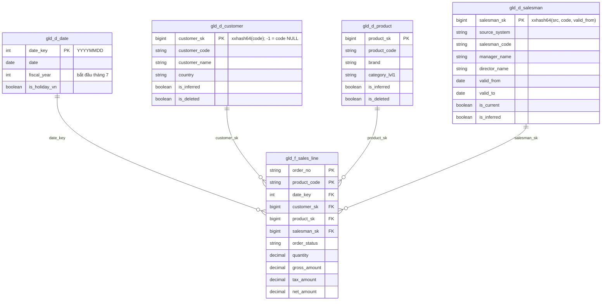

| Bảng | Notebook | Grain | Ghi |
|---|---|---|---|
| `gld_d_date` | `nb_gld_dims` | 1 ngày (2020–2035), PySpark Q9 | tạo một lần; chạy lại chỉ khi đổi lịch / ngày lễ |
| `gld_d_customer` | `nb_gld_dims` | 1 khách | SCD1 MERGE |
| `gld_d_product` | `nb_gld_dims` | 1 SP + category | SCD1 MERGE |
| `gld_d_salesman` | `nb_gld_dims` | 1 phiên bản | SCD2 MERGE (§6.5) |
| `gld_f_sales_line` | `nb_gld_fact` | 1 dòng SP của đơn, trạng thái hiện hành, **chỉ dòng ghi nhận doanh thu** | MERGE + DELETE (§6.6) |
| `gld_a_sales_month` | `nb_gld_fact` | tháng × SP × khách × salesman | replaceWhere tháng bị chạm |

### 6.4 Dim đến trễ (late-arriving dimension)

Đơn có thể đến **trước** khách / SP / salesman của nó.
- SK là **hash tất định của mã**, nên fact tính được SK ngay mà không cần dim có sẵn.
- Trước khi MERGE fact, `nb_gld_fact` chèn **inferred member** cho mã chưa có trong dim: thuộc tính `'Unknown (pending)'`, `is_inferred = true`.
- Khi dim thật đến, SCD1 MERGE ghi đè thuộc tính và đặt `is_inferred = false`. **Fact không phải sửa** vì SK không đổi.
- SCD2: inferred member có `valid_from = 1900-01-01`. Phiên bản thật đầu tiên **cập nhật tại chỗ** (cùng SK), không tạo phiên bản mới.
- `-1` chỉ dùng khi mã **NULL**.
- DQ cảnh báo số inferred member còn tồn sau N ngày (nguồn master thiếu dữ liệu).

### 6.5 SCD2 `gld_d_salesman`

- Nguồn: CDF của `slv_<src>_sales_hierarchy`. Mỗi batch Silver là một commit, nên mỗi ngày đổi là một phiên bản.
- `valid_from` = `_snapshot_date` (ngày quan sát được thay đổi). Phiên bản đầu tiên = `1900-01-01`.
- Một lần chạy có thể chứa nhiều thay đổi của cùng người (bắt kịp nhiều ngày): tách thành từng phiên bản theo thứ tự. **Một MERGE** vừa đóng bản cũ vừa chèn bản mới, nên nguyên tử. Rerun không tạo trùng nhờ điều kiện `_snapshot_date > valid_from` của bản current.

```sql
CREATE OR REPLACE TEMP VIEW v_new AS          -- v_chg: bản current Silver của các khoá đổi, đã std_* + hash h
WITH cur AS (SELECT source_system, salesman_code, record_hash, valid_from, is_inferred FROM gld.gld_d_salesman WHERE is_current),
o AS (SELECT c.*, lag(h) OVER (PARTITION BY source_system, salesman_code ORDER BY _snapshot_date) AS prev_h FROM v_chg c),
n AS (SELECT o.*, cur.is_inferred AS cur_inferred FROM o LEFT JOIN cur USING (source_system, salesman_code)
      WHERE cur.is_inferred OR (o._snapshot_date > coalesce(cur.valid_from, DATE'1900-01-01')
                                AND coalesce(o.prev_h, cur.record_hash, '') <> o.h))
SELECT n.*,
       CASE WHEN row_number() OVER (PARTITION BY source_system, salesman_code ORDER BY _snapshot_date) = 1
                 AND (cur_inferred OR NOT EXISTS (SELECT 1 FROM gld.gld_d_salesman x
                        WHERE x.source_system = n.source_system AND x.salesman_code = n.salesman_code))
            THEN DATE'1900-01-01' ELSE n._snapshot_date END AS valid_from,
       lead(n._snapshot_date) OVER (PARTITION BY source_system, salesman_code ORDER BY _snapshot_date) AS next_from
FROM n;

MERGE INTO gld.gld_d_salesman t
USING (
  SELECT source_system AS mk_src, salesman_code AS mk_code, min(valid_from) AS first_from, 'close' AS op, … FROM v_new GROUP BY 1, 2
  UNION ALL
  SELECT NULL, NULL, NULL, 'upsert', … FROM v_new WHERE NOT is_deleted
) s
ON (s.op = 'close' AND t.source_system = s.mk_src AND t.salesman_code = s.mk_code AND t.is_current AND NOT t.is_inferred)
OR (s.op = 'upsert' AND t.salesman_sk = xxhash64(s.source_system, s.salesman_code, s.valid_from))   -- inferred: cùng SK
WHEN MATCHED AND s.op = 'close'  THEN UPDATE SET t.is_current = false, t.valid_to = date_sub(s.first_from, 1)
WHEN MATCHED AND s.op = 'upsert' THEN UPDATE SET …, t.is_inferred = false,
                                              t.valid_to = coalesce(date_sub(s.next_from, 1), DATE'9999-12-31'), t.is_current = s.next_from IS NULL
WHEN NOT MATCHED AND s.op = 'upsert' THEN INSERT (salesman_sk, …, valid_from, valid_to, is_current, is_inferred)
  VALUES (xxhash64(s.source_system, s.salesman_code, s.valid_from), …, s.valid_from,
          coalesce(date_sub(s.next_from, 1), DATE'9999-12-31'), s.next_from IS NULL, false);
```
- Flatten salesman → team lead → manager → director **tại phiên bản đó** (self-join point-in-time).
- Bị xoá ở nguồn: chỉ đóng bản current.
- **Dựng lại** (sửa logic SCD2): full reload Silver `*_sales_hierarchy` từ landing (replay từng ngày theo thứ tự), rồi full reload `gld_d_salesman` và fact. **Không** dựa vào CDF cũ, vì nó bị xoá theo retention.

### 6.6 Fact & aggregate

```sql
-- v_orders_cur: bản thắng giữa các nguồn cho v_keys (§6.7), đã parse + std_*; lỗi nghiệp vụ đã tách ra quarantine
-- trước đó: chèn inferred member cho mã chưa có trong dim (§6.4)
CREATE OR REPLACE TEMP VIEW v_fact_src AS
SELECT c.order_no, c.product_code, c.source_system, c.order_status,
       CAST(date_format(c.order_date,'yyyyMMdd') AS INT) AS date_key,
       CASE WHEN c.customer_code IS NULL THEN -1 ELSE xxhash64(c.customer_code) END AS customer_sk,
       CASE WHEN c.product_code  IS NULL THEN -1 ELSE xxhash64(c.product_code)  END AS product_sk,
       coalesce(ds.salesman_sk, -1) AS salesman_sk,
       c.quantity, c.price, c.quantity * c.price AS gross_amount, c.tax_rate,
       round(c.quantity * c.price * c.tax_rate, 2) AS tax_amount,
       c.quantity * c.price + round(c.quantity * c.price * c.tax_rate, 2) AS net_amount,
       is_sales_recognized(c.order_status) AS _recognized
FROM v_orders_cur c
LEFT JOIN gld.gld_d_salesman ds ON ds.source_system = c.source_system AND ds.salesman_code = c.salesman_code
                               AND c.order_date BETWEEN ds.valid_from AND ds.valid_to;     -- point-in-time

MERGE INTO gld.gld_f_sales_line t USING v_fact_src s
ON  t.order_no = s.order_no AND t.product_code = s.product_code
AND t.date_key IN (SELECT DISTINCT date_key FROM v_fact_src)          -- cắt phạm vi quét
WHEN MATCHED AND NOT s._recognized THEN DELETE
WHEN MATCHED THEN UPDATE SET *
WHEN NOT MATCHED AND s._recognized THEN INSERT *;
```
- Cắt phạm vi dựa trên giả định `order_date` của một dòng đơn không đổi; DQ kiểm giả định này (§8.2). Vi phạm thì full reload fact.
- **Aggregate:** tháng bị chạm = tháng của `v_fact_src`. Tính lại các tháng đó rồi `replaceWhere month_key IN (…)`.
- **Late arrival** (đơn tháng 1 đến giữa tháng 2): watermark `updated_at` bắt được → Silver upsert → CDF → fact MERGE → tháng 1 tính lại.

### 6.7 Khoá cần xử lý theo mode

| Mode | Fact | Dim SCD1 | SCD2 |
|---|---|---|---|
| normal | khoá trong CDF của `slv_*_orders` | khoá trong CDF của Silver tương ứng | phiên bản trong CDF |
| rerun `[D1, D2]` | khoá trong `slv_orders_event` có `_batch_id ∈ [D1, D2]` ∪ khoá trong `v_quarantine_open` (entity orders) | MERGE **toàn bộ** Silver (so hash, chỉ dòng đổi mới ghi; dim nhỏ) | không làm gì (cần sửa thì full reload §6.5) |
| full reload | toàn bộ Silver | toàn bộ | §6.5 |

---

## 7. Semantic model & refresh

| Hạng mục | Chốt |
|---|---|
| `sm_sales` | Direct Lake trên `gld.*` · quan hệ 1-* single direction · date table · ẩn SK và cột `_` · `is_inferred` hiện được để lọc |
| Refresh | tắt auto-reframe; activity *Semantic model refresh* cuối `pl_daily_core`, **chỉ khi Gold đổi và mọi bước PASS** |
| Measures | Sales, Net Sales, Qty, Sales LY, YoY %, MTD/YTD (năm tài chính tháng 7), Top N Customer |
| Report | `rpt_sales` · `rpt_platform_health` (`table_run`, `check_result`, `ingestion_batch`, `v_quarantine_open`) |
| RLS | ở `sm_sales` (theo vùng / cây bán hàng) khi cần |

**"Incremental" có 3 nghĩa:**

| Nghĩa | Cơ chế |
|---|---|
| Ingest | watermark / checksum / CDC |
| Transform | Silver: delivery chưa LOADED · Gold: CDF + MERGE |
| Refresh semantic | Direct Lake **không cần** incremental refresh: refresh chỉ là reframe sang version Delta mới, vài giây, không chép dữ liệu |

Power BI Incremental Refresh (`RangeStart` / `RangeEnd`) chỉ dành cho model Import, dùng khi phải rời Direct Lake (vượt guardrail SKU…). Khi đó: lọc `order_date`; lưu 5 năm; **refresh 3 tháng gần nhất để phủ thời gian đến trễ**; tháng cũ hơn bị chạm thì refresh riêng partition đó qua XMLA.

---

## 8. meta, DQ, đối soát

### 8.1 Schema `meta` — 3 bảng + 1 view

| Thông tin | Ở đâu |
|---|---|
| Config | `nb_config` (Git) |
| Đọc nguồn tới đâu | view `v_watermark` |
| Delivery nào có, đã nạp chưa | **`ingestion_batch`** |
| Bảng nào chạy lúc nào, kết quả, đã xử lý tới version nào | **`table_run`** |
| DQ + đối soát | **`check_result`** |
| Gold stream đọc tới đâu | `Files/_checkpoints/gld/` |
| Activity lỗi gì | Monitoring hub |

```sql
CREATE TABLE IF NOT EXISTS meta.ingestion_batch (            -- 1 dòng = 1 delivery · MERGE theo (batch_id, source_system, entity, delivery_id)
  batch_id STRING, source_system STRING, entity STRING, delivery_id STRING, delivered_at_utc TIMESTAMP,
  load_strategy STRING, window_start STRING, window_end STRING, landing_path STRING,
  files_written INT, rows_copied BIGINT, source_checksum STRING,          -- từ manifest
  rows_read BIGINT, rows_changed BIGINT, rows_unchanged BIGINT, rows_quarantined BIGINT,
  watermark_value STRING COMMENT 'db_incremental: max(updated_at) · file: window_end · cdc: LSN',
  schema_changes STRING,
  status STRING COMMENT 'LOADED | FAILED',
  loaded_run_id STRING, loaded_at_utc TIMESTAMP, error_message STRING
) USING DELTA;

CREATE TABLE IF NOT EXISTS meta.table_run (                   -- 1 dòng = 1 sự kiện · append
  run_id STRING, batch_from STRING, batch_to STRING, run_mode STRING, layer STRING, table_name STRING,
  event STRING COMMENT 'STARTED | SUCCEEDED | FAILED',
  rows_in BIGINT, rows_inserted BIGINT, rows_updated BIGINT, rows_deleted BIGINT, rows_quarantined BIGINT,
  delta_version BIGINT,
  source_versions MAP<STRING, BIGINT> COMMENT 'version các bảng nguồn đã xử lý tới (§3.7 mức 4)',
  event_at_utc TIMESTAMP, error_message STRING
) USING DELTA;

CREATE TABLE IF NOT EXISTS meta.check_result (                -- 1 dòng = 1 check · append
  run_id STRING, batch_id STRING, check_id STRING, check_type STRING COMMENT 'dq | recon',
  table_name STRING, grain_value STRING, expected DECIMAL(38,4), actual DECIMAL(38,4), threshold DECIMAL(38,4),
  severity STRING, status STRING COMMENT 'PASS | WARN | FAIL', sample_keys STRING, checked_at_utc TIMESTAMP
) USING DELTA;

CREATE OR REPLACE VIEW meta.v_watermark AS
SELECT source_system, entity,
       max(watermark_value) AS watermark_value,
       max_by(source_checksum, delivered_at_utc) AS source_checksum
FROM meta.ingestion_batch WHERE status = 'LOADED'
GROUP BY source_system, entity;
```
- Delivery dở dang = có manifest mà không có dòng LOADED. Không cần trạng thái trung gian.
- Watermark tiến **cùng dòng** với LOADED, nên không bao giờ lệch.
- `table_run`: STARTED mà không có kết thúc nghĩa là session chết.
- Retention: `table_run`, `check_result` giữ 13 tháng; `ingestion_batch` giữ cùng landing.
- Một writer cho mỗi bảng state (`nb_slv_load` cho `ingestion_batch`); `pl_master_daily` concurrency = 1. Khi có nhiều pipeline ghi song song thì chuyển `ingestion_batch` sang Fabric SQL Database.

### 8.2 DQ (`nb_dq` → `check_result`)

| Nguồn rule | Check | Severity |
|---|---|---|
| `TABLES[].dq` | khoá not null, unique theo grain | critical |
| `TABLES[].dq` | tỉ lệ quarantine | critical > ngưỡng |
| `SOURCES[].expected = daily` | có delivery LOADED trong ngày (`pl_sla_watch`) | warning |
| code | orphan / inferred member tồn > N ngày · outlier · ngày tương lai | warning |
| code | `order_date` của một dòng đơn không đổi giữa các sự kiện | critical (vi phạm thì full reload fact) |
| code | SCD2 không chồng lấp, đúng 1 current | critical |
| code | `schema_changes` khác NULL · volume lệch > 3× TB 7 ngày | warning |

### 8.3 Đối soát (`nb_ops_recon`)

| Check | Grain | Tolerance |
|---|---|---|
| Source ↔ landing: db `rows_copied` = `rows_read`; file `files_written` = số file đọc | delivery | 0 |
| landing ↔ Silver: `rows_read = rows_changed + rows_unchanged + rows_quarantined` | delivery | 0 |
| Silver ↔ fact: số dòng + `gross_amount` của đơn ghi nhận doanh thu | ngày, tháng | 0 |
| fact ↔ aggregate | tháng | 0 |
| fact ↔ report (DAX qua semantic link) | tháng | 0 |
| thuế | tháng | 0,01 |

---

## 9. Điều phối — dependency, fail, cảnh báo, lịch

### 9.1 Quan hệ giữa các job

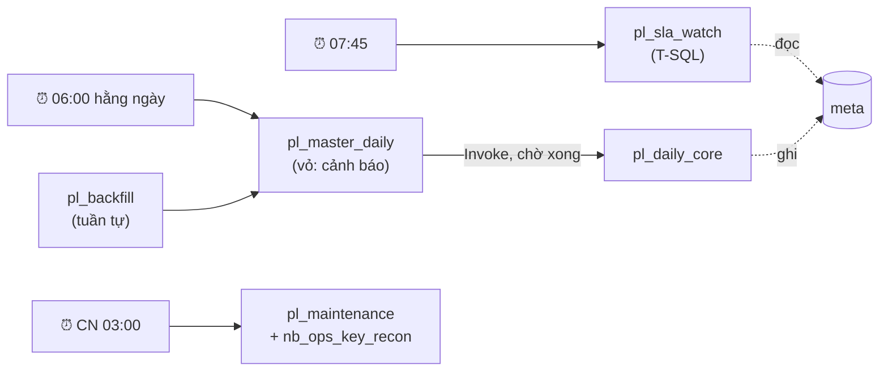

| Job | Gọi bởi | Ràng buộc |
|---|---|---|
| `pl_master_daily` | lịch · `pl_backfill` · tay | concurrency = 1 (lượt sau xếp hàng) |
| `pl_daily_core` | chỉ `pl_master_daily` | — |
| `pl_backfill(list)` | tay | gọi `pl_master_daily` **tuần tự** cho từng phần tử (ngày, hoặc khối `p_window_start/_end`); tắt lịch trong lúc chạy |
| `pl_sla_watch` | lịch 07:45 | độc lập, để vẫn báo được khi master **không hề chạy** |
| `pl_maintenance` | CN 03:00 | OPTIMIZE / VACUUM / dọn landing rác / `nb_ops_key_recon`; xa giờ 06:00 |

### 9.2 `pl_master_daily` — vỏ bắt lỗi một chỗ

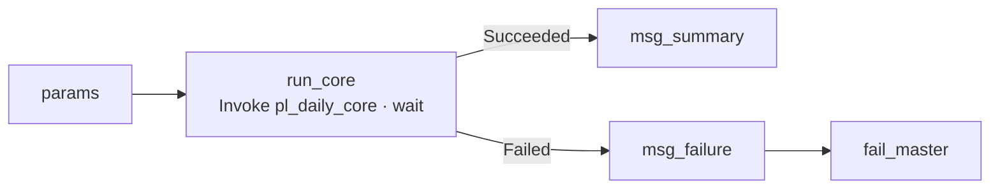
- Trong Fabric pipeline, nhiều dependency trên một activity là điều kiện **AND**. Bọc lõi trong một Invoke cho phép bắt **mọi** lỗi ở một chỗ.
- `fail_master` giữ trạng thái FAILED; nếu không có nó, nhánh cảnh báo chạy xong sẽ làm pipeline hiện Succeeded.
```
@concat('❌ pl_daily_core FAILED · batch ', pipeline().parameters.p_load_date,
        ' · mode ', pipeline().parameters.p_mode,
        ' · core run ', activity('run_core').output.pipelineRunId,
        ' · lỗi: ', activity('run_core').error.message)
```
- `msg_summary`: số entity đã nạp, số bảng Gold đã chạy, số WARN, số quarantine mở, link `rpt_platform_health`. Ngày không có gì thì chỉ ghi "không có dữ liệu mới".

### 9.3 `pl_daily_core`

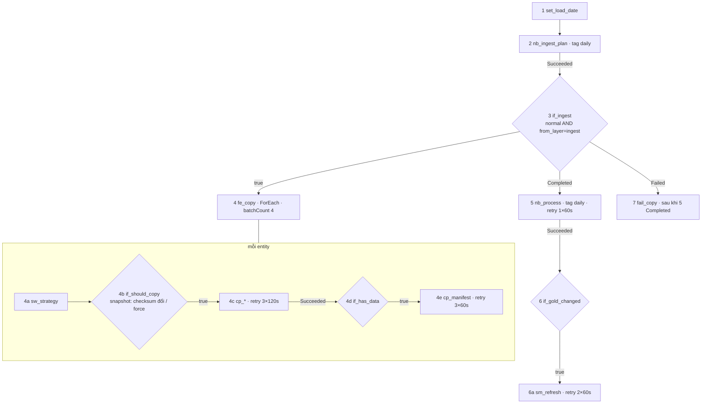

| # | Activity | Chạy khi | Retry · timeout | Nếu fail |
|---|---|---|---|---|
| 1 | `set_load_date` | đầu tiên | — | — |
| 2 | `nb_ingest_plan` | 1 Succeeded | 1×60s · 10′ | core FAILED, không Copy, không xử lý |
| 3 | `if_ingest` | 2 Succeeded | — | FAILED nếu Copy bên trong lỗi |
| 4 | `fe_copy` (song song 4) | 3 = true | — | FAILED nếu **bất kỳ** entity lỗi; entity khác vẫn chạy hết |
| 4b | `if_should_copy` + Lookup checksum | trong ForEach | Lookup 2×30s | coi như phải Copy |
| 4c | `cp_db` / `cp_file` | 4b = true | 3×120s · 30′ | entity đó không có manifest, lượt sau làm lại |
| 4d | `if_has_data` | 4c Succeeded | — | — |
| 4e | `cp_manifest` | 4d = true | 3×60s · 5′ | như 4c |
| 5 | `nb_process` | 3 **Completed** | 1×60s · 60′ | core FAILED (§9.5) |
| 6 | `if_gold_changed` | 5 Succeeded **và** 3 Succeeded | — | — |
| 6a | `sm_refresh` | 6 = true | 2×60s · 10′ | data đúng, report cũ, refresh tay |
| 7 | `fail_copy` | 3 **Failed** và 5 **Completed** | — | ép core FAILED dù phần còn lại thành công |

- Copy lỗi một entity **không chặn** entity khác (5 nối bằng Completed), nhưng pipeline vẫn FAILED (7) và report không refresh (6 cần 3 Succeeded).
- Activity bên ngoài If không phụ thuộc được vào activity **bên trong** If, nên 6 phụ thuộc vào If `if_ingest` (3).
- `cp_manifest`: Copy với source là truy vấn literal trên SQL endpoint của `lh_platform` (`SELECT '…' AS batch_id, @{activity('cp_…').output.rowsCopied} AS rows_copied, …`), sink JSON (K11a).
- **Nếu K6 không đạt** (không dùng chung session): thêm cổng trước 5 theo biến Append variable trong ForEach **tuần tự** (K11b), để ngày không có gì không mở session thứ hai.

### 9.4 `nb_process` — hai pha

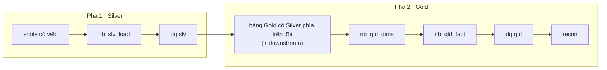

```python
%run nb_config
%run nb_common
gold_ran = []

# Pha 1 — Silver
slv_work = pending_deliveries(p_mode, p_load_date, p_load_date_to, select_sources(SOURCES, p_entities, p_from_layer))
if slv_work:
    run_dag([node("slv_load", "nb_slv_load", entities=list(slv_work)),
             node("dq_slv",   "nb_dq", layer="slv", deps=["slv_load"])])

# Pha 2 — Gold
if p_full_reload and p_from_layer in ("ingest", "slv"):
    stale = add_downstream(gold_tables_reading(slv_work))           # Silver dựng lại ⇒ Gold phía sau BẮT BUỘC dựng lại
elif p_mode == "rerun" or p_full_reload:
    stale = add_downstream(select_tables(TABLES, p_entities))
else:
    stale = add_downstream([t for t in TABLES if upstream_changed_since(t, last_success_versions(t))])
if stale:
    run_dag(gold_nodes(stale) + [node("dq_gld", "nb_dq", layer="gld"), node("recon", "nb_ops_recon")])
    gold_ran = stale

notebookutils.notebook.exit(json.dumps({"silver": list(slv_work), "gold": gold_ran, "gold_changed": bool(gold_ran)}))
```
- `run_dag` bọc `runMultiple`: node fail thì các node phía sau **không chạy**, rồi `raise`.
- Dim được chọn chạy song song; fact chờ dim; aggregate chờ fact.

### 9.5 Fail ở đâu thì sao

| Fail ở | Đã ghi gì | Report | Lượt sau tự phục hồi? | Người làm gì |
|---|---|---|---|---|
| `nb_ingest_plan` | không gì | số cũ | có | xem lỗi config / Spark |
| Copy entity X | X không có manifest | số cũ (không refresh) | có: watermark X chưa tiến | kiểm kết nối / gateway / nguồn |
| `nb_slv_load`, entity Y | entity khác LOADED; Y chưa | số cũ | có: delivery Y vẫn dở | lỗi code / dữ liệu: sửa → `(D)` |
| dq slv critical | Silver đã ghi | số cũ | không | sửa (§10.5) → `(D, rerun, slv)` |
| `nb_gld_*` | Gold ghi một phần; `source_versions` chưa tiến | số cũ | có: mức 4 thấy chưa xử lý | lỗi code: sửa → `(D, from_layer=gld)` |
| dq gld / recon FAIL | Gold đã ghi, **chưa refresh** | số cũ | không | điều tra → sửa + rerun gld, hoặc `RESTORE` |
| `sm_refresh` | dữ liệu đủ | số cũ | có | refresh tay |
| session chết / timeout | `table_run` STARTED, không có kết thúc | số cũ | có | Monitoring hub; tăng timeout / capacity |
| pipeline không chạy | — | số cũ | — | `pl_sla_watch` cảnh báo 07:45 |

**Trong mọi trường hợp fail, report giữ số của lượt thành công gần nhất (L7).**

### 9.6 Tìm chỗ fail — 4 bước

1. **Tin cảnh báo**: activity lỗi, message, batch, link run.
2. **Monitoring hub** → run `pl_daily_core` → activity đỏ. Nếu là `nb_process` thì mở snapshot: khung `runMultiple` chỉ node fail; bấm vào ra cell lỗi.
3. **`table_run`**:
   ```sql
   SELECT table_name, max_by(event, event_at_utc) AS last_event, max(event_at_utc) AS at, max(error_message) AS err
   FROM meta.table_run WHERE run_id = '<core run id>' GROUP BY table_name ORDER BY at;
   ```
4. **`ingestion_batch` / `check_result` / quarantine**:
   ```sql
   SELECT * FROM meta.ingestion_batch WHERE batch_id = '20260105' AND status <> 'LOADED';
   SELECT * FROM meta.check_result    WHERE run_id = '<core run id>' AND status = 'FAIL';
   SELECT entity, dq_reason, count(*) FROM slv.v_quarantine_open GROUP BY ALL;
   ```

### 9.7 Lịch

| Pipeline | Prod | Test / Dev |
|---|---|---|
| `pl_master_daily` | 06:00 hằng ngày (Asia/Ho_Chi_Minh) | tắt (chạy tay) |
| `pl_sla_watch` | 07:45 | tắt |
| `pl_maintenance` | CN 03:00 | tay |

- Giờ chạy theo hợp đồng: sau giờ chốt của nguồn trễ nhất (file retail đến trước 02:00: **TBD** hợp đồng), trước SLA report (07:30).
- **Một lịch cho cả chuỗi**, không đặt lịch theo giờ cho từng tầng.
- Lỡ lịch: Fabric không chạy bù; lượt sau tự lấy phần thiếu.
- Chạy chồng: concurrency = 1.
- FAILED: không tự chạy lại cả pipeline.
- Deploy / backfill: tắt lịch, chạy tay, bật lại.
- Lịch là thiết lập của workspace: là một bước trong checklist deploy Prod. Kiểm xem Git có mang theo lịch không.
- Cần dữ liệu trong ngày thì chuyển sang event trigger (file đến) hoặc lịch mỗi giờ. Thiết kế không đổi, vì mọi lượt đều idempotent và chỉ chạy phần có thay đổi.

---

## 10. Sổ tay vận hành

### 10.1 Bốn núm vặn

| Núm | Tham số |
|---|---|
| Ngày nào | `p_load_date` · `p_load_date_to` (rerun khoảng ngày trong **1 lượt**) |
| Bảng nào | `p_entities` (kéo theo bảng phía sau) |
| Từ tầng nào | `p_from_layer` = ingest · slv · gld |
| Kiểu gì | `p_mode` normal · rerun · (+ `p_window_start/_end`, `p_full_reload`) |

### 10.2 Ví dụ

| Muốn | Gọi `pl_master_daily(…)` |
|---|---|
| Ngày 05/01 bình thường | `(2026-01-05)` |
| Làm lại 05/01, không gọi nguồn | `(2026-01-05, rerun, slv)` |
| Làm lại cả tháng 1, chỉ Gold, **1 session** | `(2026-01-01, p_load_date_to=2026-01-31, rerun, gld)` |
| Chỉ bảng fact | `(2026-01-05, rerun, gld, p_entities=gld.gld_f_sales_line)` |
| Chỉ retail orders, từ nguồn | `(2026-01-05, normal, ingest, p_entities=retail.orders)` |
| Nguồn sửa dữ liệu từ 01/01 | `(today, normal, ingest, p_entities=…, p_window_start=2026-01-01 00:00:00)` |
| Nạp lần đầu bảng lớn | `pl_backfill([{p_window_start: 2024-01-01, p_window_end: 2024-02-01}, …])` |
| Đổi logic một bảng Gold | `(today, normal, gld, p_entities=gld.gld_d_customer, p_full_reload=true)` |
| Đổi cách dedup Silver | `(today, normal, slv, p_entities=retail.orders, p_full_reload=true)` → Gold phía sau tự full reload |

### 10.3 Rerun ngày D ở từng tầng

| Tầng | Làm gì | Kết quả |
|---|---|---|
| Ingest | không Copy | — |
| Silver | đọc lại mọi delivery của D → MERGE upsert-newer | bản cũ thua bản đang có, nên dữ liệu đã đúng thì không đổi |
| Gold | khoá theo §6.7 → đọc current Silver → MERGE | không đổi, trừ khi logic vừa sửa (đúng mục đích) |

Ba điều hay nhầm:
1. Rerun D **không** đưa dữ liệu về trạng thái ngày D; muốn xem như ngày D thì dùng time travel.
2. Rerun một khoảng ngày thì dùng `p_load_date_to` (1 lượt, xử lý từng ngày theo thứ tự). `pl_backfill` chỉ dành cho **lấy lại nguồn** theo khối.
3. Nghỉ N ngày thì **một lượt normal** tự lấy đủ.

### 10.4 Tình huống

| # | Tình huống | Làm gì |
|---|---|---|
| 1 | Hằng ngày | lịch |
| 2 | Lỗi giữa chừng | không cần làm gì (lượt sau tự phục hồi); cần số ngay thì chạy `(D)` |
| 3 | Kiểm idempotent | `(D, rerun, slv)` 2 lần → `rows_updated = 0`, recon y hệt |
| 4 | Nghỉ N ngày | lượt normal kế tiếp |
| 5 | Môi trường mới | `nb_setup_ddl` → initial load §4.5 → bật lịch |
| 6 | Nguồn sửa dữ liệu cũ | `p_window_start` |
| 7 | Sửa bug logic | PR → `p_full_reload` bảng đó (downstream tự đi theo) |
| 8 | Quarantine | §10.5 |
| 9 | Late arrival · dim đến trễ · file trùng | không làm gì |
| 10 | Nguồn xoá cứng | CDC / snapshot tự bắt; incremental thì `nb_ops_key_recon` hằng tuần |
| 11 | Schema change | cảnh báo → PR mở rộng Gold → #7 |
| 12 | Bảng Gold hỏng | `RESTORE TABLE … VERSION AS OF v` (trong retention) → full reload downstream |
| 13 | Bảng Silver hỏng | full reload Silver từ landing |
| 14 | Mất dữ liệu một tháng | dò ngược: report → refresh → gld history → quarantine → slv (`_batch_id`) → `ingestion_batch` → manifest → nguồn |
| 15 | Yêu cầu xoá dữ liệu cá nhân | §12.3 |

### 10.5 Vòng đời quarantine

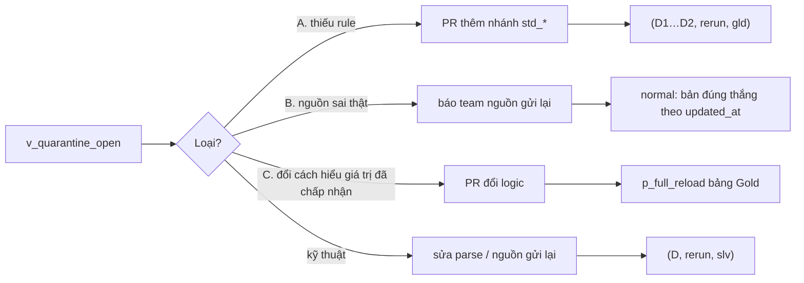
- Tìm khoảng ngày: `SELECT min(_batch_id), max(_batch_id) FROM slv.v_quarantine_open WHERE …`.
- Lỗi nghiệp vụ xử lý ở Gold, nên sửa rule chỉ cần **rerun Gold**; rerun Gold luôn gồm khoá đang quarantine (§6.7).
- Không sửa tay quarantine hay bảng dữ liệu.

---

## 11. Hiệu năng, bảo trì, chi phí

| Việc | Quy tắc |
|---|---|
| Đo nền | thời lượng từng bảng (`table_run`), `numFiles` / size, dữ liệu quét khi report chạy; **CU** qua Fabric Capacity Metrics app |
| Session | 1 session/lượt; starter pool; tránh thư viện riêng không cần thiết |
| Chỉ chạy phần đổi | §3.7, đòn bẩy chi phí lớn nhất |
| Clustering | ứng viên `slv_*_orders(_bk)`, `gld_f_sales_line(date_key)`, khai báo `cluster_by`, bật sau khi đo |
| Partition | chỉ khi mỗi partition ≥ ~1 GB |
| MERGE lớn | luôn cắt phạm vi trong `ON`; deletion vectors |
| File nhỏ | optimize write + OPTIMIZE hằng tuần |
| V-Order | bật cho `gld.*` |
| VACUUM | retention ≥ 7 ngày **và** lớn hơn độ trễ tối đa của CDF stream; quá tay thì stream lỗi và mất RESTORE |
| Landing | dọn thư mục không có manifest sau 7 ngày; chuyển tầng lưu trữ rẻ sau 90 ngày |
| Capacity | theo dõi throttling; tách capacity cho BI khi người dùng đông |

---

## 12. Môi trường, CI/CD, bảo mật & quản trị dữ liệu

### 12.1 Môi trường

| Workspace | Nhánh | State |
|---|---|---|
| DataPlatform-Dev | `dev` | riêng; nguồn: bản sao / môi trường dev của nguồn |
| DataPlatform-Test | `test` | riêng; nguồn: UAT |
| DataPlatform-Prod | `main` | riêng; nguồn: production (chỉ đọc) |

Giá trị khác nhau giữa môi trường (connection, email nhận cảnh báo, giờ lịch) nằm ở **Variable Library**. Notebook gắn lakehouse theo tên.

### 12.2 CI/CD

```
feature branch → PR vào dev (review notebook / pipeline / SQL diff)
  → Dev: Update all → nb_setup_ddl → chạy 1 ngày → DQ + recon PASS → rerun 2 lần y hệt
  → PR dev → test → UAT với business (đối soát số)
  → PR test → main → Prod: tắt lịch → deploy → nb_setup_ddl → chạy 1 lượt → kiểm → bật lịch → tag
```
- Deploy bằng Git integration theo từng workspace. Khi cần tự động hoá thì dùng Deployment Pipelines hoặc thư viện `fabric-cicd` (GitHub Actions).
- `nb_setup_ddl` idempotent; thay đổi schema thêm bằng cell mới (`ALTER TABLE … ADD COLUMNS`), không sửa cell cũ.
- Test: hàm `nb_common` có notebook test trên dữ liệu mẫu (`nb_test_common`); DQ/recon là test dữ liệu chạy mỗi lượt.

### 12.3 Bảo mật & quản trị dữ liệu

| Hạng mục | Chốt |
|---|---|
| Identity | Connection dùng **workspace identity / service principal**, không dùng tài khoản cá nhân; nguồn on-prem đi qua gateway |
| Bí mật | chỉ trong Connection / Key Vault, không nằm trong Git |
| Quyền | DE: Contributor ở Dev/Test, hạn chế ở Prod · analyst: chỉ semantic model / report · landing và Silver (có PII) không mở cho analyst |
| PII | `SOURCES[].pii_columns`: Gold chỉ đưa vào cột cần cho báo cáo; gắn sensitivity label; RLS ở `sm_sales` |
| Quyền xoá dữ liệu cá nhân | ngoại lệ có kiểm soát đối với landing bất biến: job riêng ghi lại file landing đã loại bản ghi, rồi full reload Silver/Gold liên quan; có biên bản |
| Lineage | Fabric lineage view + truy vết `_batch_id` / `_delivery_id` |
| Audit | `meta.*` + Monitoring hub + Delta history (`userMetadata`) |

---

## 13. Núm vặn khi lớn lên

| Chỗ | Hiện tại | Khi nhiều bảng / dữ liệu lớn |
|---|---|---|
| Ingest DB | watermark / snapshot + checksum | `db_cdc` / Mirroring; Copy partition dynamic range |
| Silver | 1 notebook generic, từng ngày | vẫn generic; entity event gộp nhiều ngày một MERGE; clustering `_bk` |
| Gold | 2 notebook | mỗi domain 1–2 notebook; template cho dim SCD1 chuẩn |
| Điều phối | 1 master | master theo nguồn/domain + orchestrator; vẫn 1 session mỗi master |
| State | `meta` ở lakehouse | `ingestion_batch` sang Fabric SQL Database khi nhiều writer |
| Tổ chức | 1 workspace / môi trường | workspace theo tầng hoặc domain khi phân quyền / capacity riêng |
| Report | Direct Lake | + aggregate, theo dõi guardrail SKU |

---

## 14. Lộ trình & Definition of Done

| Bước | Làm | DoD |
|---|---|---|
| **0 Hợp đồng nguồn** | chốt với team nguồn: khoá, xoá cứng, múi giờ, giờ gửi, CDC có không | design/01 không còn TBD chặn |
| **1 Spike** | K6 · K9 · K11a (+ K11b nếu K6 fail) | kết luận ghi §15.2 |
| **2 Ingest + Silver** | `nb_setup_ddl` · `nb_config` · `nb_common` (phần landing/ghi/audit) · `nb_ingest_plan` · `pl_daily_core` 1–5 · `nb_slv_load` · `nb_process` pha 1 · `pl_master_daily` | T1 normal: entity có dữ liệu LOADED · T2 rerun: `rows_changed = 0` · T3 watermark tiến · T4 file trùng: không trùng dòng · T5 kill giữa chừng: lượt sau tự nạp · T6 Copy lỗi 1 entity: entity khác LOADED, FAILED, có cảnh báo · T7 snapshot không đổi: không Copy · T8 ngày không có gì: không chạy Gold, không refresh |
| **3 EDA** | `nb_ops_eda` → `dq_findings.md` → `std_*`, múi giờ, khoá sự kiện (D50) | mọi TBD có giá trị |
| **4 Lát dọc orders** | `nb_gld_dims` (date + inferred) · `nb_gld_fact` · `nb_dq` · `nb_ops_recon` · refresh · 1 trang report · `pl_sla_watch` | 7 lượt liên tục · S2 · check PASS · fail mỗi bước → report giữ số cũ |
| **5 Master + SCD2** | dim SCD1 + hợp nhất nguồn · soft delete · `gld_d_salesman` | đổi cơ cấu tổ chức → report đúng theo thời điểm · bắt kịp 3 ngày đúng số phiên bản · dim đến trễ tự lành |
| **6 DQ/recon đủ + cảnh báo** | rule · recon · `rpt_platform_health` | mỗi tình huống lỗi bắt đúng mức |
| **7 Vận hành** | `pl_backfill` · `pl_maintenance` · `nb_ops_key_recon` · runbook (§9.5, §10) | chạy được từng dòng §10.4 |
| **8 Report** | `sm_sales` · `rpt_sales` | report = SQL = recon |
| **9 Promote** | §12.2 | Prod xanh 3 ngày; UAT ký nhận số |
| **10 Drills** | late arrival · mất dữ liệu một tháng · schema change · đo hiệu năng | runbook + bằng chứng |

---

## 15. Quyết định & còn mở

### 15.1 Quyết định hiện hành

| # | Quyết định | Thay cho (PLAN / design cũ) |
|---|---|---|
| D22 | Landing cho mọi nguồn, bất biến, có manifest | — |
| D23 | Silver đọc delivery chưa LOADED; Gold đọc **CDF stream `availableNow`**, chỉ lấy khoá | Bronze stream |
| D24 | Khai báo theo bảng (`TABLES`): DAG, khoá, pattern, DQ chuẩn, SLA; rule nghiệp vụ trong code | D2 |
| D25 | `table_run`: sự kiện STARTED / SUCCEEDED / FAILED + `source_versions` | D18 |
| D27 | `check_result` gộp DQ + recon | `dq_result`, `reconciliation_result` |
| D28 | SCD2 MERGE incremental, nhiều phiên bản mỗi lần, nguyên tử; bản đầu `1900-01-01`; dựng lại = replay landing | effective date còn mở |
| D29 | Snapshot: `_snapshot_date` = ngày thay đổi gần nhất; ảnh cũ không đè ảnh mới | — |
| D30 | `p_from_layer`, `p_entities`, `p_load_date_to`, `p_window_end` | — |
| D31 | Chiến lược ingest theo khả năng nguồn; **CDC ưu tiên khi có**; cận trên tính ở nguồn | D15 (cận trên theo `p_load_date`) |
| D32 | Fact MERGE cắt phạm vi theo `date_key`, có DQ kiểm giả định | — |
| D38 | Config là code (`nb_config`) | bảng `cfg_*`, ADR 013 |
| D39 | Watermark = view trên `ingestion_batch`; `meta` 3 bảng | `watermark_state`, D3, D5, D19 |
| D40 | Một lịch cho cả chuỗi + watchdog `pl_sla_watch` | — |
| D41 | Direct Lake: refresh = reframe khi Gold đổi và mọi thứ PASS | — |
| D42 | Quarantine một bảng, 2 stage; lỗi nghiệp vụ sửa bằng rerun Gold | `quarantine_<entity>` |
| D43 | Hai mode normal / rerun | D6 (normal / rerun / reprocess) |
| D44 | Ba cấp quyết định: pipeline / `nb_process` / notebook | — |
| D45 | **Không có bảng Bronze**: landing là raw duy nhất; Silver = raw đã dedup theo nguồn; clean ở Gold | design/05, 06 |
| D46 | Landing `YYYYMMDD/<source>/<entity>/run=<RunId>/` + manifest; `batch_id` = ngày | `<source>/<entity>/load_date=/batch=` |
| D47 | 1 session Spark mỗi lượt | — |
| D48 | Dedup theo khoá ở Silver; bỏ hash file và trạng thái trung gian | D9, D17, D20 |
| D49 | `pl_master_daily` là vỏ bắt lỗi; `fail_copy`; refresh chỉ khi PASS | — |
| D50 | Khoá `slv_orders_event`: A (có status) chờ EDA | — |
| D51 | **Chỉ chạy phần có thay đổi**, 4 mức | — |
| D52 | Tie-breaker giữa delivery dùng `_delivered_at_utc` (từ manifest), không dùng RunId | — |
| D53 | Dim đến trễ: SK hash tất định + inferred member; `-1` chỉ khi mã NULL | `-1` cho mọi orphan |
| D54 | Full reload Silver ⇒ bắt buộc full reload Gold phía sau | — |
| D55 | Xoá cứng ở nguồn incremental: `nb_ops_key_recon` hằng tuần | — |

### 15.2 Còn mở

| Mục | Chốt ở | Dự phòng |
|---|---|---|
| **K6** hai activity notebook dùng chung session (session tag, high concurrency) | Bước 1 | cổng pipeline + ForEach tuần tự (K11b); hoặc Lookup T-SQL cho plan |
| **K9** CDF stream `availableNow` trên Runtime hiện tại | Bước 1 | lưu version trong `table_run.source_versions`, đọc bằng `table_changes` |
| **K11a** `cp_manifest` qua Copy literal | Bước 1 | `nb_process` ghi manifest từ output Copy |
| K10 Liquid Clustering | Bước 10 | không clustering |
| Giờ gửi file, CDC có không, xoá cứng có không | hợp đồng nguồn (Bước 0) | giả định: file trước 02:00; không CDC; orders không xoá cứng |
| Múi giờ `updated_at` ERP, tên cột file, khoá sự kiện (D50) | EDA | TBD / A |
| `net_amount` gồm thuế không, xử lý `tax_rate` bẩn | EDA + business | gross trước thuế, net = gross + tax |
| Ngưỡng DQ | sau vài tuần số liệu | 5%, 3× |

---

## Phụ lục A — Áp dụng cho dự án mô phỏng

| Khác biệt | Mô phỏng | Thật |
|---|---|---|
| Nguồn | `CompanyA-Source` (Fabric SQL DB + lakehouse drop) do simulator ghi | hệ thống của team nguồn, có thể qua gateway |
| Đồng hồ ERP | virtual clock: `updated_at` là giờ giả lập. Cận trên incremental = `p_load_date + 1 ngày` (truyền vào `window_end`), **không** dùng `SYSUTCDATETIME()` | `now_nguồn − commit_lag` (§4.1) |
| Chạy | `pl_sim_drive`: `nb_00_sim_daily` → `pl_master_daily(p_load_date = ngày giả lập)`; chạy thử 7 ngày: mỗi giờ 1 ngày | lịch 06:00 |
| Nhiều ngày | `pl_backfill` theo **từng ngày** (đồng hồ nguồn đi theo ngày) | một lượt normal tự bắt kịp |
| Master ERP | snapshot Copy mỗi ngày nhưng checksum chặn khi không đổi | như nhau |
| Reset | reset simulator ⇒ truncate slv/gld, xoá `ingestion_batch`, `_checkpoints`, **và landing** (ngoại lệ duy nhất của L2) | không có |
| Kịch bản lỗi | simulator bơm: late arrival, file gửi lại / trùng / thiếu / dở, bad rows, schema change, org change, master delete | xảy ra tự nhiên; drill ở Test |
