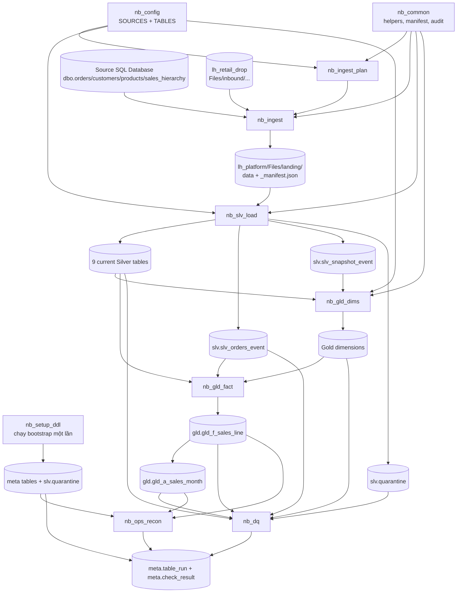

# Dependency map: source → Landing → Silver → Gold → kiểm tra

Tài liệu này mô tả dependency theo code deployable trong `fabric/platform/` ngày
2026-10-12. Khi tài liệu kiến trúc mục tiêu khác hành vi hiện tại, dùng notebook,
`nb_config`, pipeline JSON và runbook để xác định cách chạy thực tế.

## 1. Sơ đồ chạy end-to-end

`pl_master_daily` và `pl_daily_core` đều có một Pipeline Notebook activity tên
`run_process`, gọi `nb_process`. `nb_process` lần lượt gọi notebook con bằng
`notebookutils.notebook.run`; nó không chạy tất cả notebook thành các activity
độc lập. `pl_master_daily` có retry 1 lần sau 60 giây, vì vậy Monitor có thể hiện
hai dòng `run_process`: lần đầu và lần retry. `pl_backfill` lặp từng ngày tuần tự.

## 2. Nguồn, file đầu vào và Landing

Mỗi source ID là `source_system.entity`. `source_object` là bảng SQL hoặc thư mục
trong Lakehouse nguồn. SQL đi từ workspace `p_source_workspace`, item
`p_erp_item`; file đọc từ `p_drop_lakehouse` ở cùng source workspace. Notebook
ghi file đã giao vào **platform Lakehouse** `lh_platform`.

| Source ID | Đầu vào vật lý (`nb_config.SOURCES`) | Loại / chiến lược | Landing do `nb_ingest` ghi | Silver đích |
|---|---|---|---|---|
| `wholesale.orders` | SQL `dbo.orders`, watermark `updated_at` | event / `db_incremental` | `Files/landing/{batch}/wholesale/orders/run={delivery_id}/` (Parquet + `_manifest.json`) | `slv.slv_wholesale_orders` + `slv.slv_orders_event` |
| `wholesale.customers` | SQL `dbo.customers` | snapshot / `db_full_snapshot` | `Files/landing/{batch}/wholesale/customers/run={delivery_id}/` (Parquet + manifest) | `slv.slv_wholesale_customers` + `slv.slv_snapshot_event` |
| `wholesale.products` | SQL `dbo.products` | snapshot / `db_full_snapshot` | `Files/landing/{batch}/wholesale/products/run={delivery_id}/` (Parquet + manifest) | `slv.slv_wholesale_products` + `slv.slv_snapshot_event` |
| `wholesale.sales_hierarchy` | SQL `dbo.sales_hierarchy` | snapshot / `db_full_snapshot` | `Files/landing/{batch}/wholesale/sales_hierarchy/run={delivery_id}/` (Parquet + manifest) | `slv.slv_wholesale_sales_hierarchy` + `slv.slv_snapshot_event` |
| `retail.orders` | `Files/inbound/retail/orders`; fallback hiện có `Files/inbound/orders` | event / `file_new_or_changed` | `Files/landing/{batch}/retail/orders/run={delivery_id}/` (file gốc + manifest) | `slv.slv_retail_orders` + `slv.slv_orders_event` |
| `retail.customers` | `Files/inbound/retail/customers`; fallback `Files/inbound/customers` | snapshot / `file_new_or_changed` | `Files/landing/{batch}/retail/customers/run={delivery_id}/` (file gốc + manifest) | `slv.slv_retail_customers` + `slv.slv_snapshot_event` |
| `retail.products` | `Files/inbound/retail/products`; fallback `Files/inbound/products` | snapshot / `file_new_or_changed` | `Files/landing/{batch}/retail/products/run={delivery_id}/` (file gốc + manifest) | `slv.slv_retail_products` + `slv.slv_snapshot_event` |
| `retail.sales_hierarchy` | `Files/inbound/retail/sales_hierarchy`; fallback `Files/inbound/sales_hierarchy` | snapshot / `file_new_or_changed` | `Files/landing/{batch}/retail/sales_hierarchy/run={delivery_id}/` (file gốc + manifest) | `slv.slv_retail_sales_hierarchy` + `slv.slv_snapshot_event` |
| `reference.categories` | `Files/inbound/reference/categories`; fallback `Files/inbound/categories` | snapshot / `file_new_or_changed` | `Files/landing/{batch}/reference/categories/run={delivery_id}/` (file gốc + manifest) | `slv.slv_reference_categories` + `slv.slv_snapshot_event` |

`{batch}` là `YYYYMMDD`. `_manifest.json` được ghi sau data và đóng vai trò dấu
commit cho một delivery. `nb_slv_load` chỉ đọc delivery có manifest. Với file,
code hiện đọc CSV/TXT; snapshot chọn file có ngày mới nhất trong tên nếu tên có
ngày `YYYYMMDD`. File nguồn không bị di chuyển/xóa bởi notebook.

## 3. Dependency từng bảng

### Silver

| Bảng | Nguồn trực tiếp | Notebook tạo/cập nhật | Dependency / ghi chú |
|---|---|---|---|
| `slv.slv_wholesale_orders` | Landing của `wholesale.orders` | `nb_slv_load` | Current state, event merge theo business key; cần manifest tương ứng. |
| `slv.slv_retail_orders` | Landing của `retail.orders` | `nb_slv_load` | Current state, event merge theo business key; cần manifest tương ứng. |
| `slv.slv_wholesale_customers` | Landing của `wholesale.customers` | `nb_slv_load` | Current state snapshot; snapshot mới còn có thể tạo tombstone cho key bị thiếu. |
| `slv.slv_retail_customers` | Landing của `retail.customers` | `nb_slv_load` | Như trên. |
| `slv.slv_wholesale_products` | Landing của `wholesale.products` | `nb_slv_load` | Current state snapshot. |
| `slv.slv_retail_products` | Landing của `retail.products` | `nb_slv_load` | Current state snapshot. |
| `slv.slv_wholesale_sales_hierarchy` | Landing của `wholesale.sales_hierarchy` | `nb_slv_load` | Current state snapshot; Gold SCD2 đọc history dùng chung bên dưới. |
| `slv.slv_retail_sales_hierarchy` | Landing của `retail.sales_hierarchy` | `nb_slv_load` | Current state snapshot; Gold SCD2 đọc history dùng chung bên dưới. |
| `slv.slv_reference_categories` | Landing của `reference.categories` | `nb_slv_load` | Hiện là Silver reference; Gold config chưa khai báo dimension category. |
| `slv.slv_orders_event` | Các delivery event của cả hai `*.orders` | `nb_slv_load` | Shared append-only event history; Gold fact rerun lọc keys theo batch từ bảng này. DQ kiểm uniqueness khi chọn orders hoặc ALL. |
| `slv.slv_snapshot_event` | Tất cả delivery snapshot (customers/products/sales_hierarchy/categories) | `nb_slv_load` | Shared append-only observations; Gold `gld_d_salesman` hiện lọc `entity='sales_hierarchy'`. |
| `slv.quarantine` | Dòng lỗi từ Silver và Gold fact | `nb_setup_ddl`, `nb_common` helpers được gọi từ `nb_slv_load`/`nb_gld_fact` | Shared quarantine; DQ báo open count hiện tại. |

Mỗi current Silver source table chỉ cần Landing của source tương ứng. Shared
event/history tables được ghi cùng delivery trong `nb_slv_load`, không phải
notebook hay bước riêng để chạy.

### Gold

| Bảng Gold | Inputs diretti | Notebook | Thứ tự / ý nghĩa |
|---|---|---|---|
| `gld.gld_d_date` | Không có bảng upstream; ngày được sinh theo phạm vi code | `nb_gld_dims` | Tạo trước fact; `date_key` là date dimension key. |
| `gld.gld_d_customer` | `slv.slv_wholesale_customers`, `slv.slv_retail_customers` | `nb_gld_dims` | Hợp nhất nguồn, chọn quan sát mới nhất theo business key; fact có thể thêm inferred member khi mã chưa có. |
| `gld.gld_d_product` | `slv.slv_wholesale_products`, `slv.slv_retail_products` | `nb_gld_dims` | Hợp nhất nguồn; fact có thể thêm inferred member cho product code chưa có. |
| `gld.gld_d_salesman` | `slv.slv_snapshot_event` lọc `entity='sales_hierarchy'` (cả wholesale và retail) | `nb_gld_dims` | SCD2 dựng từ lịch sử snapshot, phụ thuộc snapshot history chứ không chỉ current table. Fact có thể thêm inferred salesman. |
| `gld.gld_f_sales_line` | Một hoặc cả hai order current tables; `gld_d_customer`, `gld_d_product`, `gld_d_salesman`; khi `rerun` có batch filter thì `slv.slv_orders_event`. `nb_config.TABLES` còn khai báo `gld_d_date` là dependency. | `nb_gld_fact` | DQ chuẩn hóa order/date/amount/status; `Delivered` được giữ trong fact. Code tạo `date_key` từ `order_date` nhưng hiện không join `gld_d_date`; bảng date vẫn là Gold output bắt buộc cho full DQ. Cần ít nhất một Silver orders table. |
| `gld.gld_a_sales_month` | `gld.gld_f_sales_line` | `nb_gld_fact` | Aggregate theo tháng/sản phẩm/khách hàng/salesman; chạy sau fact trong cùng notebook. |

`nb_gld_fact` tạo inferred customer/product/salesman nếu mã đơn hàng chưa có trong
dimension. Vì thế dimensions phải được dựng trước fact, nhưng thiếu một dimension
member không đồng nghĩa phải dừng fact. Ngược lại, thiếu cả hai Silver orders
tables khiến fact không thể dựng.

`nb_config.TABLES.depends_on` khai báo và kiểm tra tên dependency hợp lệ, nhưng
hiện **không tự điều khiển thứ tự chạy**. Thứ tự được hardcode trong
`nb_process`: dimensions trước fact, fact trước aggregate, DQ sau Gold và
reconciliation cuối cùng. `nb_common.run_dag` là helper riêng, hiện không được
dùng bởi `nb_process`.

## 4. Notebook, file và pipeline nào phụ thuộc vào gì

| Item/file | Đọc/import | Ghi hoặc gọi | Chạy khi nào |
|---|---|---|---|
| `nb_setup_ddl.Notebook/notebook-content.py` | Lakehouse mặc định `lh_platform` | Tạo schema `slv/gld/meta`, ba bảng meta, `meta.v_watermark`, `slv.quarantine`, `slv.v_quarantine_open` | Bootstrap trước pipeline lần đầu hoặc sau reset có chủ đích. `p_clean_schema=true` xóa bảng managed trong ba schema nhưng giữ `Files/landing`; không dùng như retry thường. |
| `nb_config.Notebook/notebook-content.py` | Không đọc dữ liệu | Khai báo 9 `SOURCES` và 6 Gold `TABLES`; import qua `%run` | Nguồn cấu hình của planner, Silver, Gold và DQ; không cần chạy riêng trong pipeline. |
| `nb_common.Notebook/notebook-content.py` | Lakehouse mặc định, manifest và meta | Helper cho manifest, audit, quarantine, Delta, versioning; còn có helper `run_dag` | Import bằng `%run nb_common`; đây là helper notebook, **không tự gọi `%run` bên trong chính nó**. Chỉ chạy trực tiếp để debug/helper-specific kiểm tra khi cell không chứa code khác. |
| `nb_ingest_plan.Notebook/notebook-content.py` | `%run nb_config`, `%run nb_common`, `meta.v_watermark` | Trả source plan/window/checksum metadata | Bước 1 khi `normal + ingest`; không copy dữ liệu. |
| `nb_ingest.Notebook/notebook-content.py` | `%run nb_common`, plan từ planner, source SQL Database và drop Lakehouse | Ghi Landing data + manifest | Bước 2 khi `normal + ingest`; cần quyền đọc source items, source paths đúng, và quyền ghi platform Lakehouse. |
| `nb_slv_load.Notebook/notebook-content.py` | `%run nb_config`, `%run nb_common`, Landing manifests/data, metadata schema/table | Ghi 9 current Silver source tables, hai shared histories, quarantine, `meta.ingestion_batch` | Sau khi có delivery trong Landing. Có thể chạy lại bằng replay manifest (rerun/slv). |
| `nb_gld_dims.Notebook/notebook-content.py` | `%run nb_config`, `%run nb_common`, Silver customers/products, `slv.slv_snapshot_event` | Bốn Gold dimensions | Trước `nb_gld_fact`; `gld_d_date` tự sinh, salesman cần snapshot history. |
| `nb_gld_fact.Notebook/notebook-content.py` | `%run nb_config`, `%run nb_common`, Silver orders/event, bốn Gold dimensions | `gld.gld_f_sales_line`, `gld.gld_a_sales_month`, Gold quarantine | Sau dimensions và sau khi ít nhất một Silver orders table tồn tại. |
| `nb_dq.Notebook/notebook-content.py` | `%run nb_config`, `%run nb_common`, source Silver, shared event, Gold và quarantine | `meta.check_result` | Sau Silver/Gold. `p_layer=all` cần đủ sáu Gold; `p_layer=slv` scoped DQ chỉ kiểm entities được chọn và event orders nếu liên quan. |
| `nb_ops_recon.Notebook/notebook-content.py` | `%run nb_common`, fact, monthly aggregate, `meta.ingestion_batch` | `meta.check_result` | Sau full Gold + DQ; không chạy như xác nhận một partial entity run. |
| `nb_process.Notebook/notebook-content.py` | `%run nb_config`, `%run nb_common`, Lakehouse + metadata; truyền root default Lakehouse cho child | Gọi tuần tự planner → ingest → Silver → dims → fact → DQ → recon; audit từng stage | Entry point pipeline. Thực thi preflight và điều kiện skip/replay. Đây là notebook cần chạy cho end-to-end. |
| `nb_sla_watch.Notebook/notebook-content.py` | `%run nb_config`, `%run nb_common`, `meta.ingestion_batch` | Check/warning SLA theo expected source | Chạy độc lập sau bootstrap theo lịch giám sát; không phải dependency của daily data flow. |
| `nb_maintenance.Notebook/notebook-content.py` | `%run nb_common`, Delta tables hiện có | OPTIMIZE maintenance | Chạy riêng theo lịch bảo trì; không phải prerequisite của daily pipeline. |
| `pl_master_daily.DataPipeline/pipeline-content.json` | Parameters pipeline | Một Notebook activity `run_process` → `nb_process` | Entry point khuyến nghị cho daily run; retry 1 lần/60s. |
| `pl_daily_core.DataPipeline/pipeline-content.json` | Cùng bộ parameters | Cũng một Notebook activity `run_process` → cùng `nb_process` | Runner tương đương; không chạy song song với `pl_master_daily` cho cùng batch. |
| `pl_backfill.DataPipeline/pipeline-content.json` | `p_start_date`, `p_end_date`, source params | `ForEach` tuần tự từng ngày, gọi `nb_process` cho mỗi ngày | Chạy backfill có chủ đích; hiện cấu hình mỗi ngày `p_entities=ALL`, `p_from_layer=ingest`, `p_full_reload=false`. |
| `pl_sla_watch.DataPipeline/pipeline-content.json` | Cấu hình pipeline SLA | Gọi watcher nếu được lên lịch | Giám sát delivery; độc lập với Silver/Gold processing. |
| `pl_maintenance.DataPipeline/pipeline-content.json` | Cấu hình bảo trì | Gọi maintenance notebook nếu được lên lịch | Bảo trì Delta; độc lập với daily dependency chain. |

Mọi notebook Spark đọc/ghi `meta`, `slv`, `gld` cần gắn `lh_platform` làm default
Lakehouse trong Fabric để các tên namespace ngắn như `meta.table_run` được phân
giải. `nb_ingest` còn truy cập Lakehouse nguồn `lh_retail_drop` qua workspace
source; đây là dependency dữ liệu ngoài platform Lakehouse.

## 5. Thứ tự chạy khi cần chạy tay

### Lần triển khai đầu / workspace mới

1. Xác nhận workspace có `lh_platform`; gắn làm default Lakehouse cho notebook
   xử lý và bảo đảm Fabric Git binding đã cập nhật.
2. Chạy `nb_setup_ddl` một lần để tạo schema/meta/quarantine.
3. Xác nhận `CompanyA-Source`, SQL item `sqldb_erp_wholesale`, drop Lakehouse
   `lh_retail_drop`, credentials/permissions và file folders đầu vào.
4. Chạy `pl_master_daily` với mặc định (hoặc chạy `nb_process` để debug một lượt).

### Pipeline tự chạy theo thứ tự này

1. `nb_ingest_plan` đọc watermark và chọn source/window.
2. `nb_ingest` đọc SQL/file, tạo Landing data và manifest.
3. `nb_process` tìm manifest đúng batch/source rồi `nb_slv_load` nạp current Silver
   và shared history/quarantine.
4. `nb_gld_dims` dựng date/customer/product/salesman dimensions.
5. `nb_gld_fact` dựng fact rồi monthly aggregate.
6. `nb_dq` xác nhận dữ liệu; full scope tiếp theo chạy `nb_ops_recon`.
7. `nb_process` ghi terminal audit status.

Không cần thêm Lookup/ForEach cho từng bảng trong master pipeline: source ordering
và table dependencies được xử lý bởi config và logic bên trong `nb_process`/notebook
con. Chỉ `pl_backfill` dùng ForEach để lặp **ngày**, tuần tự.

### Tiếp tục sau lỗi

| Điểm lỗi / trạng thái có sẵn | Chạy tiếp |
|---|---|
| Chưa có Landing manifest cho source cần nạp | `normal / ingest`; planner và source ingest chạy lại. |
| Landing đã có, Silver chưa hoàn tất | `rerun / slv`, đúng `p_load_date` hoặc khoảng ngày, `p_entities=ALL` (hoặc source IDs cần nạp); replay manifest rồi Gold/DQ. |
| Silver current + history đã đúng, chỉ cần dựng lại Gold | `rerun / gld`, `p_entities=ALL`; chạy dimensions → fact/aggregate → full DQ → recon. |
| Một source/entity cần ingest và kiểm Silver riêng | `normal / ingest`, `p_entities=<source IDs>`; kết thúc `PARTIAL`, không phải full Gold readiness. |
| Gold fact báo không có Silver orders | Kiểm `slv.slv_wholesale_orders`, `slv.slv_retail_orders`, manifest orders và `meta.ingestion_batch`; nếu Landing orders tồn tại thì `rerun / slv` với đúng batch, nếu chưa có thì `normal / ingest`. |
| `meta`/namespace error ngay đầu | Xác nhận `lh_platform` default binding và chạy `nb_setup_ddl` nếu bootstrap chưa được thực hiện; retry không tự tạo context Lakehouse. |

Đối chiếu runbook [`RUNBOOK.md`](RUNBOOK.md) để đặt đúng ngày và mode. Tránh
chạy hai pipeline đồng thời trên cùng một batch; cùng lúc chạy nhiều runner cũng
có thể tạo tranh chấp Spark capacity.

## 6. Metadata/check dependencies

| Bảng/view | Ai tạo | Ai đọc/ghi | Vì sao cần |
|---|---|---|---|
| `meta.ingestion_batch` | `nb_setup_ddl` | `nb_common`, planner watermark, Silver, recon, SLA watcher | Delivery lifecycle, counts, watermark, replay/provenance. |
| `meta.v_watermark` | `nb_setup_ddl` | `nb_ingest_plan` | Watermark/checksum theo source; chỉ dựa delivery status `LOADED`. |
| `meta.table_run` | `nb_setup_ddl` | mọi audit helper và `nb_process` | STARTED/SUCCEEDED/FAILED/SKIPPED/NO_DATA/PARTIAL events per stage/table. |
| `meta.check_result` | `nb_setup_ddl` | `nb_dq`, `nb_ops_recon` qua `nb_common` | Kết quả DQ và reconciliation theo check ID. |
| `slv.quarantine` | `nb_setup_ddl` | Silver/Gold helpers, DQ | Lưu lỗi dòng cần xử lý; khi delivery/key được sửa, helper xóa bản ghi lỗi tương ứng. View `slv.v_quarantine_open` hiện đọc toàn bộ bảng quarantine. |

Để trace một lần chạy, lọc `meta.table_run` theo `run_id`; để trace delivery,
lọc `meta.ingestion_batch` theo `batch_id` và source/entity; để xem DQ/recon,
lọc `meta.check_result` cùng `run_id`. Một notebook bị cancel/không khởi tạo
được Spark có thể chỉ để lại `STARTED`; khi Spark đã dừng thì không thể ghi terminal
event từ chính notebook đó.
